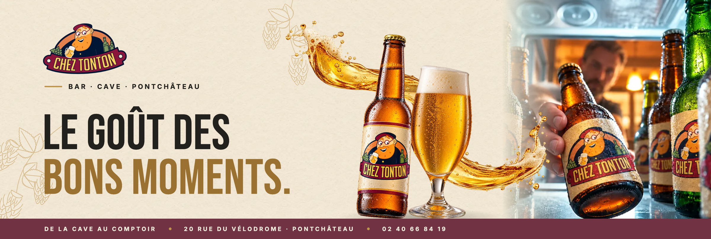
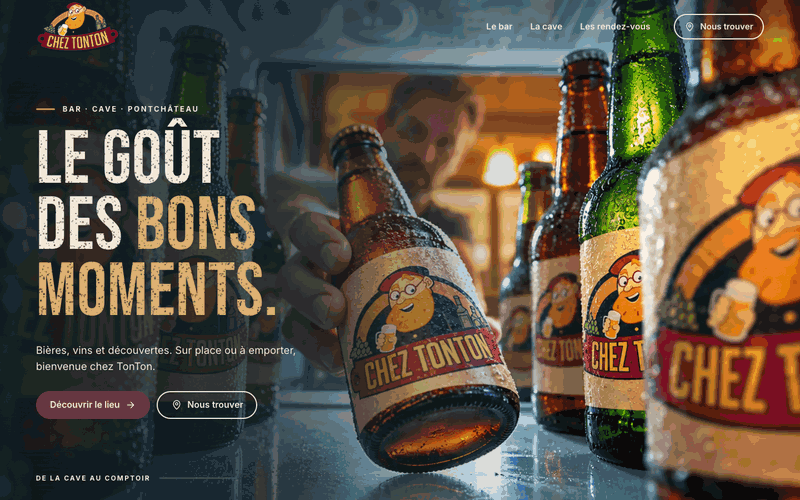
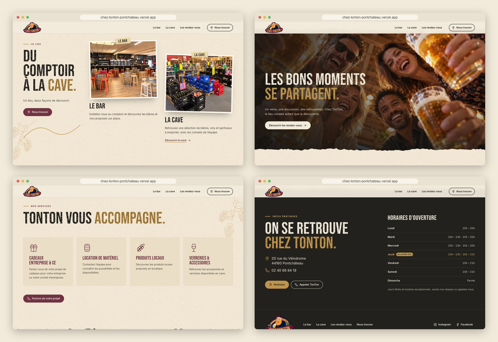
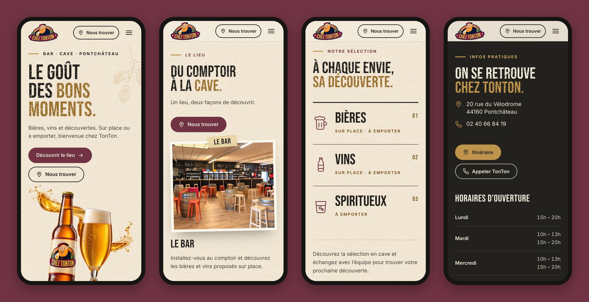

<div align="center">



<h3>A one-page website for a bar and beer &amp; wine shop in Pontchâteau, built around a scroll-driven « De la cave au comptoir » hero.</h3>

<p>
  <a href="https://chez-tonton-pontchateau.vercel.app"><strong>🌐 Live site</strong></a>
  &nbsp;·&nbsp;
  <a href="#hero-animation"><strong>🎬 How the hero works</strong></a>
  &nbsp;·&nbsp;
  <a href="#getting-started"><strong>🛠️ Run it locally</strong></a>
</p>

<p>
  <a href="https://chez-tonton-pontchateau.vercel.app"></a>
  
  
  
  
</p>

</div>

<br />

## 🚀 Overview

**Chez TonTon** is a bar and a *cave* (bottle shop) at 20 rue du Vélodrome in Pontchâteau: beers and wines on site or to take away, spirits, local products and glassware. The site tells that in one move: the camera starts **inside the fridge**, a bottle lifts out of the shot, the cold light gives way to a cream beer-poster, a glass and an arc of beer fill the composition, and the poster hands over to the real bar and cave in the next section. *De la cave au comptoir.*

The rest of the page keeps the poster language (condensed type, cream paper, malt and burgundy, engraved hops, torn edges) and keeps the two real calls to action close at hand: **Nous trouver** (map) and **Appeler TonTon** (phone).

- **Cinematic first impression**: a pinned hero assembled from the kit's photo and transparent layers, not a video
- **Clear path to the venue**: map and phone in the header, the hero, the sections and the contact block; no invented booking, newsletter or ticketing
- **Built for every visitor**: static poster on phones, short screens, `prefers-reduced-motion` and without JavaScript; keyboard and screen-reader friendly
- **Light**: 423 KB on a desktop first load (measured, 16 requests); the fridge photo is never downloaded on phones

<br />

<a name="hero-animation"></a>

## 🎬 The hero animation

<div align="center">
  <a href="https://chez-tonton-pontchateau.vercel.app"></a>
  <sub>Scroll-scrubbed on the live site · captured at 1440 × 900</sub>
</div>

<br />

The hero stays pinned for 2.25 screen heights (`225svh` track, `100svh` sticky stage) and follows the kit's timeline:

| Scroll  | What happens                                                                                              |
| :------ | :-------------------------------------------------------------------------------------------------------- |
| 0–19%   | **Frigo**: point of view from inside the fridge, slow pull-back (1.06 → 1.02); title and both actions already usable |
| 19–49%  | **Révélation**: the bottle appears on the photographed one, then swings upright toward the camera while the fridge dissolves to paper |
| 49–74%  | **Composition**: the glass rises in the foreground and the beer arc pours in along its own diagonal       |
| 74–100% | **Arc**: short drift of the arc, objects settle so the poster reads; signature *De la cave au comptoir.*  |

**Under the hood**

- 🎯 **A measured match cut.** The fridge photo is drawn with `object-fit: cover`, so the script recomputes where its bottle lands on screen for any viewport and poses the PNG bottle on it: label centre on label centre, scaled on the bottle's length (the photographed bottle points at the lens, so its width would oversize the cut).
- 🧩 **One progress value, transforms only.** Native scroll drives a single lightly smoothed 0–1 value; every layer gets `transform` and `opacity`. The arc's pour is a moving soft mask that is removed once the arc is complete.
- 🖼️ **Kit PNGs stay the masters.** `npm run images` crops each transparent layer to its visible pixels, writes AVIF + WebP at the sizes the layout uses, and records sizes and anchor points in `src/data/asset-meta.json` for the timeline.
- 🌿 **Engraved hops, drawn in code.** The approved mockup has malt hop line-art the kit didn't ship as a file; `scripts/draw-hops.mjs` generates it as one SVG symbol reused across the page.
- 🐢 **Graceful by default.** Up to 760 px wide, on screens under 560 px tall, with reduced motion and without JS, the hero is a static poster with the same title, actions and bottle, glass and arc.

<br />

## 🖥️ Sections

<div align="center">
  
</div>

<br />

| #   | Section                                  | Anchor         | Role                                                                                   |
| :-- | :--------------------------------------- | :------------- | :------------------------------------------------------------------------------------- |
| 01  | **Le goût des bons moments.**            | `#top`         | The fridge-to-poster story, *Découvrir le lieu* and *Nous trouver*                     |
| 02  | **Du comptoir à la cave.**               | `#bar-cave`    | The real space: the bar (`#bar`) and the cave, with the supplied photos                |
| 03  | **Les bons moments se partagent.**       | n/a            | Full-bleed atmosphere image between torn poster edges, 14 px parallax on desktop       |
| 04  | **À chaque envie, sa découverte.**       | `#cave`        | Bières · Vins · Spiritueux, with how each can be enjoyed; *Demander un conseil* calls  |
| 05  | **Le prochain rendez-vous ?**            | `#rendez-vous` | Points to Instagram and Facebook; a data-driven event list stays hidden until real dates exist |
| 06  | **TonTon vous accompagne.**              | `#services`    | Company & works-council gifts, equipment hire, local products, glassware               |
| 07  | **On se retrouve chez TonTon.**          | `#contact`     | Address, phone, directions and the opening hours, with today's row highlighted          |
| 08  | Footer                                   | n/a            | Logo, navigation, social links, image credits and the French alcohol health notice     |

<br />

## 📱 Mobile first, motion optional

<div align="center">
  
</div>

<br />

- Title, text and actions first, then the bottle, glass and arc; no pinned scroll
- *Nous trouver* stays in the header; the menu adds the phone number as a full-width button
- Every touch target is at least 44 px; no horizontal scroll at 390 px (checked numerically)
- Opening hours stack one slot per line on narrow screens; nothing depends on hover

<br />

## ✨ Highlights

- **🎞️ Scroll storytelling**: a five-segment timeline written to the kit's `timeline.json`, with a progress line titled *De la cave au comptoir*
- **🗺️ Real conversion paths only**: map and phone everywhere; no booking, form or newsletter that the venue doesn't run
- **🕒 Hours without JavaScript**: the table is written into the HTML at build time from `src/data/site.js`; the browser only highlights today (Europe/Paris), and never claims "open now"
- **🗓️ Honest agenda**: events render only from dates the venue publishes, past dates drop out automatically
- **♿ Accessible details**: skip link, real headings in the right order, visible focus in every theme, disclosure menu with Escape and focus return, AA contrast (a deeper malt is used for text on paper)
- **📜 Poster craft**: condensed titles with letterpress grain, torn-paper section edges done with CSS masks, engraved hops, taped photo prints
- **🔎 Ready to share**: Open Graph image, `BarOrPub` + `LiquorStore` structured data and favicons

<br />

## 💻 Tech stack

| <br />Vite 6 | <br />sharp | <br />JavaScript | <br />HTML5 | <br />CSS3 | <br />Vercel |
| :---: | :---: | :---: | :---: | :---: | :---: |

### Why this stack?

- **Vite + plain JavaScript**: a one-page site for a local venue doesn't need a framework runtime; the page is static HTML with four small modules
- **Hand-written scroll engine**: one progress value and a handful of layers; a scroll library would add weight without adding control
- **sharp**: one command turns the kit's PNG masters into trimmed AVIF/WebP and the measurements the hero reads
- **Self-hosted Bebas Neue and Inter**: poster type with French accents, no third-party font requests
- **Vercel**: every push to `main` deploys automatically

<br />

## 🎨 Design system

| Token       | Value                                                                        | Use                                              |
| :---------- | :--------------------------------------------------------------------------- | :----------------------------------------------- |
| Papier      |  | Paper background (with a seamless texture tile)  |
| Encre       |  | Text, contact block, footer                      |
| Malt        |  | Accents on dark grounds, rules, hops, focus on dark |
| Malt profond |  | Large malt titles on paper (3.7:1)              |
| Bordeaux    |  | Primary buttons, agenda block, service titles    |
| Bleu froid  |  | Only in the fridge opening's scrim               |

- **Type**: Bebas Neue for titles (uppercase, letterpress grain), Inter for text and controls; hero title up to 168 px, section titles 52–112 px, body 16–20 px
- **Grid**: 1,440 px content width, gutters from 24 px (mobile) to 72 px
- **Rhythm**: 88–168 px between sections; torn edges between paper and dark blocks
- **Motion**: blocks rise 24 px once; hero only in `transform`/`opacity`; parallax capped at 14 px

<br />

<a name="getting-started"></a>

## 🛠️ Getting started

```bash
# Clone the repository
git clone https://github.com/Jeanfr1/cheztontonwebsite.git
cd cheztontonwebsite

# Install dependencies (Node 20+)
npm install

# Start the dev server  →  http://localhost:5173
npm run dev

# Production build  →  dist/
npm run build

# Preview the production build
npm run preview

# Regenerate the AVIF/WebP images and asset-meta.json from the kit PNGs
npm run images
```

<br />

## 📁 Project structure

```
cheztontonwebsite/
├── index.html                  # Every section: hero → bar & cave → moments → cave → rendez-vous → services → contact → footer
├── src/
│   ├── main.js                 # Entry: fonts, styles, module init
│   ├── styles/main.css         # Tokens, poster type, hero modes, sections, responsive rules
│   ├── js/
│   │   ├── hero.js             # Match-cut geometry and the five-segment scroll timeline
│   │   ├── header.js           # Header tone over the hero, solid state, mobile menu
│   │   ├── content.js          # Today's opening hours row, upcoming events
│   │   └── motion.js           # Reveal on scroll, 14 px parallax
│   └── data/
│       ├── site.js             # Address, phone, links, hours, events (single source)
│       ├── timeline.js         # Hero segments from the kit
│       └── asset-meta.json     # Generated: trimmed layer sizes and anchor points
├── public/                     # Generated images (img/), torn-edge masks, OG image, favicons
├── scripts/
│   ├── build-images.mjs        # PNG masters → trimmed AVIF/WebP + asset-meta.json (sharp)
│   └── draw-hops.mjs           # Engraved hop sprig → SVG symbol
├── 01-conceito … 07-integracao # The creative kit: approved mockups, PNG layers, scripts, tokens (not deployed)
└── LEIA-ME-KIT.md              # The kit's own README (Portuguese)
```

<br />

## 🚀 Deployment

Hosted on **Vercel** and connected to this repository: every push to `main` ships to production. The creative kit stays in the repository but is excluded from deployments by `.vercelignore`.

**Live site:** [chez-tonton-pontchateau.vercel.app](https://chez-tonton-pontchateau.vercel.app)

| Setting          | Value          |
| :--------------- | :------------- |
| Framework        | Vite           |
| Build command    | `vite build`   |
| Output directory | `dist`         |

<br />

## 📌 Content checklist

Items waiting on the venue. Each one is marked `TODO(tonton)` in the code.

- [ ] Official logo file (the current PNG is a frontal reconstruction from the facade photo)
- [ ] Confirm opening hours, bank holidays and exceptions (taken from a supplied screenshot)
- [ ] Upcoming events with real dates, or keep the agenda pointing to Instagram
- [ ] Approve the site, then remove `noindex` and set the final domain (`og:url`, `og:image`)

Choices made where the kit pointed two ways:

- The mockups' sample copy (product blurbs, handwritten note) was replaced by the kit's revised French texts; the motion signature *De la cave au comptoir* takes the note's place
- Product cards show categories only (Bières · Vins · Spiritueux): no catalogue, prices or stock until real products are supplied
- The brief's malt `#BE934C` is 2.4:1 on paper, so text on paper uses a deeper malt; pure malt stays on dark grounds
- E-mail is left out because public sources disagree; the phone number is the confirmed contact
- Campaign images (fridge, draught pour, friends) are labelled as atmosphere images, never as staff or customers; the bar and cave photos are the venue's own

<br />

## 🙏 Acknowledgments

- **Chez TonTon** for the venue, its photos and its identity
- **[Mairie de Pont-Château](https://www.pontchateau.fr/contacts/chez-tonton/)** listing, the source for the address, phone and social links
- **[Bebas Neue](https://fonts.google.com/specimen/Bebas+Neue)** by Dharma Type and **[Inter](https://rsms.me/inter/)** by Rasmus Andersson (OFL)
- **[Lucide](https://lucide.dev)** for the line icons the interface icons are based on (ISC)
- **[sharp](https://sharp.pixelplumbing.com)**, **[Vite](https://vite.dev)** and **[Vercel](https://vercel.com)**

<br />

---

<div align="center">
  
  <p><strong>Le goût des bons moments</strong></p>
  <p>Built with ❤️ by <a href="https://github.com/Jeanfr1">Jean</a> for Chez TonTon</p>
  <sub>© 2026 Chez TonTon. All rights reserved.</sub>
</div>
